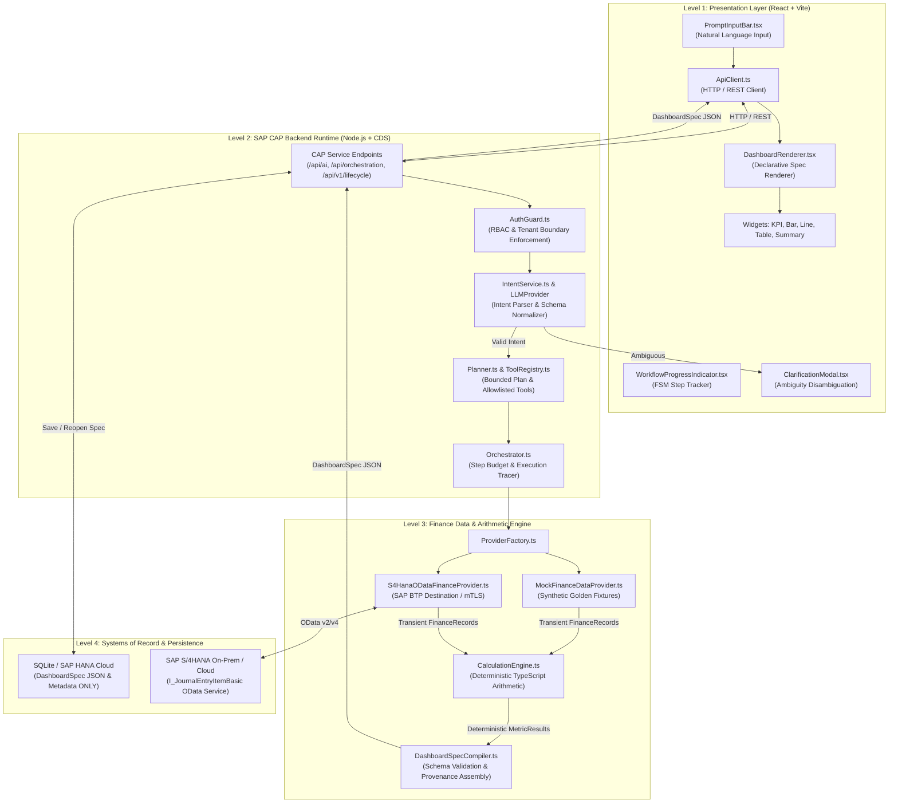
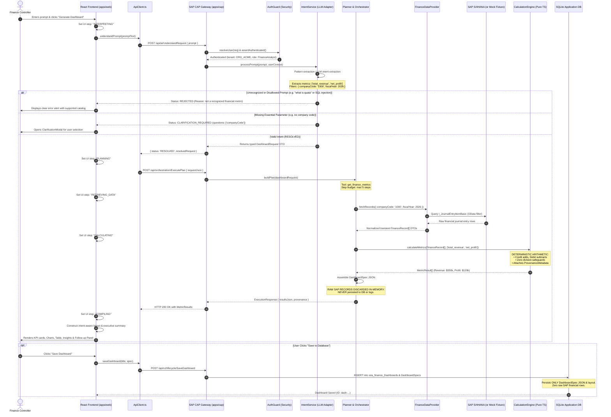

# Sria Info Tech AI Finance Dashboard Generator
## End-to-End Technical Architecture & Operational Flow Guide

This document explains the complete, step-by-step technical flow of how the system operates from the exact moment a user types a natural language request into the prompt input to the final rendering of a verified, interactive financial dashboard.

---

## 1. System Architectural Levels

The application is structured into four distinct, isolated layers to ensure strict financial correctness, data privacy, and role-based access control.

---

## 2. End-to-End Sequence Flow

The following sequence diagram details what happens when a user types:
> *"Show total revenue and profit for company 1000 in FY 2026"*
and clicks **Generate Dashboard**.

---

## 3. Detailed Component-by-Component Breakdown

### Component 1: Prompt Input & State Machine
- **Source Files**: 
  - [`PromptInputBar.tsx`](file:///c:/Users/darla/OneDrive/Desktop/SAP,AI%20project/apps/web/src/components/ai/PromptInputBar.tsx)
  - [`WorkflowProgressIndicator.tsx`](file:///c:/Users/darla/OneDrive/Desktop/SAP,AI%20project/apps/web/src/components/ai/WorkflowProgressIndicator.tsx)
  - [`WorkspacePage.tsx`](file:///c:/Users/darla/OneDrive/Desktop/SAP,AI%20project/apps/web/src/pages/WorkspacePage.tsx)
- **What it does**:
  1. Accepts user natural language input or template clicks.
  2. Initiates the Finite State Machine (FSM) progress tracker:
     - `INTERPRETING` → `PLANNING` → `RETRIEVING_DATA` → `CALCULATING` → `COMPILING`.
  3. Manages clarification states if the AI requires more context.

---

### Component 2: Frontend API Gateway Client
- **Source File**: [`api-client.ts`](file:///c:/Users/darla/OneDrive/Desktop/SAP,AI%20project/apps/web/src/services/api-client.ts)
- **What it does**:
  1. Acts as the single HTTP communication bridge between React and SAP CAP backend.
  2. Routes `understandPrompt`, `executeRequest`, `saveDashboard`, `reopenDashboard`, `renameDashboard`, and `refreshDashboard`.
  3. Includes offline fallback logic with deterministic golden figures when backend network connectivity is unavailable.

---

### Component 3: Security & Authorization Boundary
- **Source File**: [`auth-guard.ts`](file:///c:/Users/darla/OneDrive/Desktop/SAP,AI%20project/apps/cap/srv/lib/auth/auth-guard.ts)
- **What it does**:
  1. Inspects every incoming HTTP request header (SAP XSUAA JWT token or CAP mock context).
  2. Resolves `userId`, `tenant` (`organizationId`), and roles (`FinanceAnalyst`, `FinanceManager`, `TenantAdmin`).
  3. Strictly isolates multi-tenant data: Tenant Beta can never view or manipulate Tenant Alpha's saved dashboards.
  4. Blocks anonymous access with HTTP `401 Unauthorized`.

---

### Component 4: AI Intent Interpretation Engine
- **Source Files**: 
  - [`ai-service.ts`](file:///c:/Users/darla/OneDrive/Desktop/SAP,AI%20project/apps/cap/srv/ai-service.ts)
  - [`intent-service.ts`](file:///c:/Users/darla/OneDrive/Desktop/SAP,AI%20project/apps/cap/srv/ai/intent-service.ts)
  - [`mock-llm-provider.ts`](file:///c:/Users/darla/OneDrive/Desktop/SAP,AI%20project/apps/cap/srv/ai/mock-llm-provider.ts)
- **What it does**:
  1. **Prompt Sanitization**: Blocks prompt injections (e.g. `ignore previous instructions`, `drop table`, `<script>`).
  2. **Metric Allowlist Enforcement**: Checks against approved catalog (`total_revenue`, `total_expenses`, `net_profit`, `profit_margin`). Rejects unsupported metrics (e.g., EBITDA, ARR, churn) with 0% hallucination.
  3. **Entity Extraction**: Extracts `companyCode` (e.g., `1000`, `2000`) and `fiscalYear` (e.g., `2026`).
  4. **Strict Schema Emission**: Produces a typed `DashboardRequest` adhering to Zod schema contracts in [`schemas.ts`](file:///c:/Users/darla/OneDrive/Desktop/SAP,AI%20project/packages/contracts/src/schemas.ts).

---

### Component 5: AI Planner & Orchestrator
- **Source Files**: 
  - [`planner.ts`](file:///c:/Users/darla/OneDrive/Desktop/SAP,AI%20project/apps/cap/srv/ai/planner.ts)
  - [`orchestrator.ts`](file:///c:/Users/darla/OneDrive/Desktop/SAP,AI%20project/apps/cap/srv/ai/orchestrator.ts)
  - [`tool-registry.ts`](file:///c:/Users/darla/OneDrive/Desktop/SAP,AI%20project/apps/cap/srv/ai/tool-registry.ts)
- **What it does**:
  1. Translates `DashboardRequest` into an execution plan (`DataPlan`).
  2. Constrains tool execution to allowlisted tools (only `get_finance_metrics` is approved).
  3. Enforces a hard budget ceiling (maximum 5 execution steps) to make autonomous recursive loops physically impossible.
  4. Records execution trace timestamps without logging confidential financial figures.

---

### Component 6: Finance Data Provider Layer
- **Source Files**: 
  - [`provider-factory.ts`](file:///c:/Users/darla/OneDrive/Desktop/SAP,AI%20project/apps/cap/srv/providers/provider-factory.ts)
  - [`mock-finance-data-provider.ts`](file:///c:/Users/darla/OneDrive/Desktop/SAP,AI%20project/apps/cap/srv/providers/mock-finance-data-provider.ts)
  - [`s4hana-odata-finance-provider.ts`](file:///c:/Users/darla/OneDrive/Desktop/SAP,AI%20project/apps/cap/srv/providers/s4hana-odata-finance-provider.ts)
- **What it does**:
  1. Connects to the data source:
     - **Live Mode**: Calls SAP S/4HANA OData endpoint `I_JournalEntryItemBasic` via SAP BTP Destination Service.
     - **Mock/Dev Mode**: Loads synthetic golden fixtures (`SYNTHETIC_FINANCE_RECORDS`).
  2. Normalizes records into typed `FinanceRecord` DTOs with fields:
     - `recordId`, `companyCode`, `fiscalYear`, `fiscalPeriod`, `amount`, `currency`, `debitCreditCode` (`S` or `H`), `financialAccountType` (`REVENUE` or `EXPENSE`).

---

### Component 7: Deterministic Arithmetic Engine (Zero LLM Math)
- **Source File**: [`calculation-engine.ts`](file:///c:/Users/darla/OneDrive/Desktop/SAP,AI%20project/apps/cap/srv/lib/finance/calculation-engine.ts)
- **What it does**:
  > [!IMPORTANT]
  > Financial arithmetic is **100% deterministic TypeScript code**. An LLM is **NEVER** allowed to calculate totals, subtract expenses, or divide margins.
  1. **Total Revenue**: Sums revenue records. Credits (`H`) add; Debits (`S`) subtract (customer refunds/returns).
  2. **Total Expenses**: Sums expense records. Debits (`S`) add; Credits (`H`) subtract (supplier refunds).
  3. **Net Profit**: Deterministic formula `Total Revenue - Total Expenses`.
  4. **Profit Margin**: `(Net Profit / Total Revenue) * 100`. If `Total Revenue === 0`, it emits `0.00%` and sets flag `isZeroDenominator: true` to prevent division by zero runtime crashes.
  5. Attaches **Data Provenance**:
     - `sourceSystem`: `SAP_S4HANA_LIVE` or `SAP_SYNTHETIC_OFFLINE_FIXTURE`
     - `retrievedAt`: ISO 8601 UTC timestamp
     - `calculationVersion`: `1.0.0`
     - `isSynthetic`: `boolean`
     - `appliedFilters`: `{ companyCode, fiscalYear }`

---

### Component 8: Declarative Visual Dashboard Renderer
- **Source Files**:
  - [`DashboardRenderer.tsx`](file:///c:/Users/darla/OneDrive/Desktop/SAP,AI%20project/apps/web/src/components/dashboard/DashboardRenderer.tsx)
  - [`KpiCardWidget.tsx`](file:///c:/Users/darla/OneDrive/Desktop/SAP,AI%20project/apps/web/src/components/dashboard/KpiCardWidget.tsx)
  - [`BarChartWidget.tsx`](file:///c:/Users/darla/OneDrive/Desktop/SAP,AI%20project/apps/web/src/components/dashboard/BarChartWidget.tsx)
  - [`LineChartWidget.tsx`](file:///c:/Users/darla/OneDrive/Desktop/SAP,AI%20project/apps/web/src/components/dashboard/LineChartWidget.tsx)
  - [`TableWidget.tsx`](file:///c:/Users/darla/OneDrive/Desktop/SAP,AI%20project/apps/web/src/components/dashboard/TableWidget.tsx)
  - [`ProvenanceBanner.tsx`](file:///c:/Users/darla/OneDrive/Desktop/SAP,AI%20project/apps/web/src/components/dashboard/ProvenanceBanner.tsx)
  - [`FollowUpPanel.tsx`](file:///c:/Users/darla/OneDrive/Desktop/SAP,AI%20project/apps/web/src/components/dashboard/FollowUpPanel.tsx)
- **What it does**:
  1. Renders the typed `DashboardSpec` JSON.
  2. Adapts layout dynamically:
     - **1 metric requested**: Shows 1 KPI card + period trend line chart + table.
     - **2+ metrics requested**: Shows multi-KPI cards + comparative bar chart + trend line + table.
     - **Company 2000**: Displays operating loss in red with negative margin warnings.
  3. Generates analytical context:
     - Executive summary sentences derived from verified ratios.
     - Margin health thresholds (healthy vs. low margin).
     - Revenue-to-expense coverage multiplier.
  4. Follow-up panel:
     - **Presentation-only requests** (e.g. "Switch to line chart") update React widgets instantly without re-querying SAP.
     - **Data-changing requests** (e.g. "Switch to company 2000") trigger a fresh authorized retrieval.

---

### Component 9: Persistence & Lifecycle Management
- **Source Files**:
  - [`dashboard-lifecycle-service.ts`](file:///c:/Users/darla/OneDrive/Desktop/SAP,AI%20project/apps/cap/srv/dashboard-lifecycle-service.ts)
  - [`MyDashboardsPage.tsx`](file:///c:/Users/darla/OneDrive/Desktop/SAP,AI%20project/apps/web/src/pages/MyDashboardsPage.tsx)
  - [`sqlite.db`](file:///c:/Users/darla/OneDrive/Desktop/SAP,AI%20project/apps/cap/sqlite.db)
- **What it does**:
  1. Allows users to save, reopen, rename, and delete dashboards.
  2. Stores **only dashboard metadata and layout specifications** (`DashboardSpec` JSON).
  3. **Strict Data Retention Rule**: Raw SAP accounting transactions and financial ledger rows are **never stored** in the application database.
  4. When a saved dashboard is reopened, it is visually badged as **STALE** until the user clicks "Refresh Data" to re-authenticate and fetch current SAP figures.

---

## 4. Key Architectural Guarantees Summary

| Guarantee | How It Is Enforced | Source File |
| :--- | :--- | :--- |
| **Zero LLM Arithmetic** | All formulas implemented in compiled TypeScript functions | [`calculation-engine.ts`](file:///c:/Users/darla/OneDrive/Desktop/SAP,AI%20project/apps/cap/srv/lib/finance/calculation-engine.ts) |
| **Zero Raw Financial Persistence** | Database models store only `specJson`; ledger rows are transient in memory | [`dashboard-lifecycle-service.ts`](file:///c:/Users/darla/OneDrive/Desktop/SAP,AI%20project/apps/cap/srv/dashboard-lifecycle-service.ts) |
| **Strict Multi-Tenant Isolation** | All queries filtered by verified token tenant (`organizationId`) | [`auth-guard.ts`](file:///c:/Users/darla/OneDrive/Desktop/SAP,AI%20project/apps/cap/srv/lib/auth/auth-guard.ts) |
| **Prompt Injection Defense** | Input sanitization, mode override blocking, SQL injection rejection | [`mock-llm-provider.ts`](file:///c:/Users/darla/OneDrive/Desktop/SAP,AI%20project/apps/cap/srv/ai/mock-llm-provider.ts) |
| **No Infinite Agent Loops** | Orchestrator step budget capped at 5; single approved tool | [`orchestrator.ts`](file:///c:/Users/darla/OneDrive/Desktop/SAP,AI%20project/apps/cap/srv/ai/orchestrator.ts) |
| **Audit Provenance Traceability** | Every result carries retrieval timestamp, engine version, and source system | [`schemas.ts`](file:///c:/Users/darla/OneDrive/Desktop/SAP,AI%20project/packages/contracts/src/schemas.ts) |

