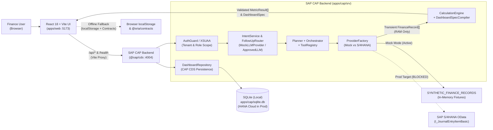
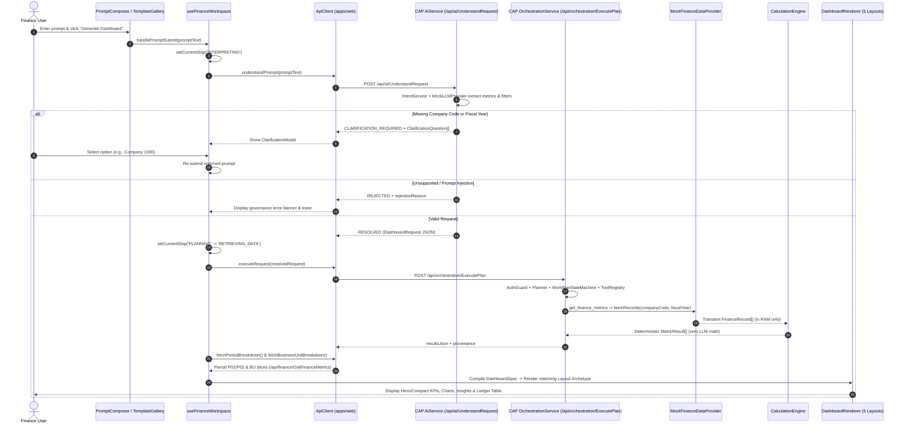
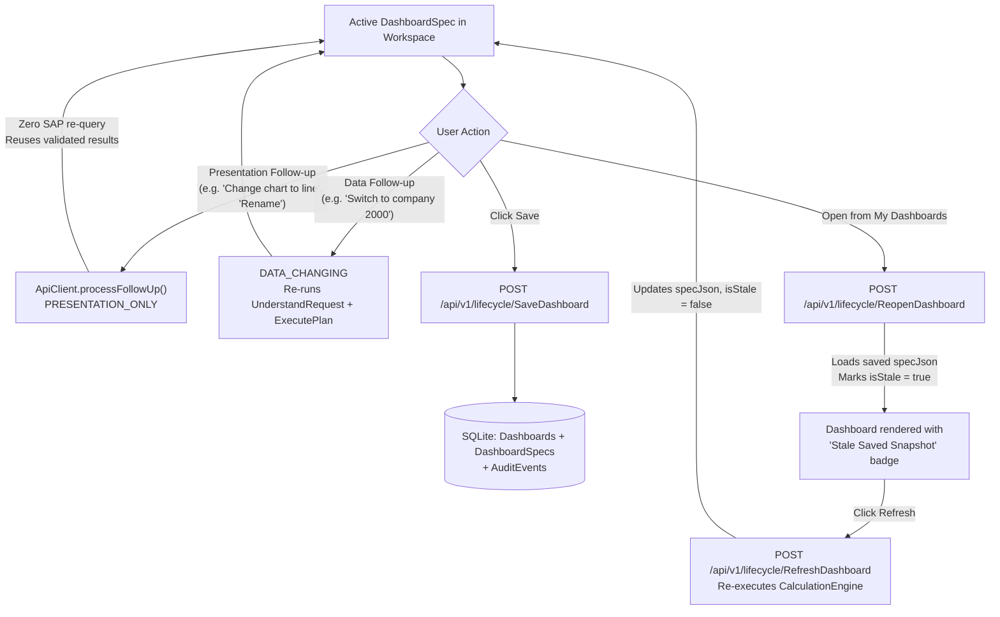

# Sria Info Tech — Complete System Architecture, Data Access & Codebase Reference

**Product:** Sria Info Tech AI Finance Dashboard Generator (`Sria Analytics`)  
**Architecture Pattern:** Modular Monorepo (`React 18 + Vite` Frontend + `SAP CAP Node.js` Backend + `Zod` Shared Contracts)

---

## 1. Complete Tech, Tool & Resource Stack (12-Pillar Map)

This table maps the exact technologies, tools, and services actually present in this repository—clearly separating **Active Local Runtime** from **Configured SAP BTP Production Targets**.

| # | Pillar | Category | Exact Tools & Files in This Codebase | Runtime Status |
|---|---|---|---|---|
| **01** | **Clients & UI** | Non-SAP Frontend | `React 18.3.1`, `TypeScript 5.7.3`, `Vite 6.4.6`, `Recharts 2.15.4`, `lucide-react`, `sonner`, `clsx`, custom CSS design system (`apps/web/src/`) | **Active** (`http://localhost:5173`) |
| **02** | **Dev Proxy & Static Routing** | Edge / Gateway | Vite `server.proxy` (`/api` & `/health` → `http://localhost:4004` in `apps/web/vite.config.ts`); SAP BTP `staticfile_buildpack` + `srv-api` destination in `apps/cap/mta.yaml` | **Active** locally / MTA configured |
| **03** | **Identity & Security** | SAP + App Guard | `AuthGuard` (`apps/cap/srv/lib/auth/auth-guard.ts`), SAP XSUAA descriptor (`apps/cap/xs-security.json` — `FinanceAnalyst`, `FinanceManager`, `TenantAdmin`), Tenant Scoping (`organization_ID`), Prompt Injection & Metric Allowlist Guards | **Active** (`AuthGuard` + local fallback) / XSUAA for BTP |
| **04** | **SAP CAP Backend** | SAP Middleware | `@sap/cds` `10.2.2`, `Node.js` ESM, `Express 4.21.2`, CDS Services: `AiService`, `OrchestrationService`, `FinanceDataService`, `DashboardLifecycleService`, `DashboardService`, `MetricCatalogService`, `AdminService`, `HealthService` | **Active** (`http://localhost:4004`) |
| **05** | **AI Intent & Orchestration** | AI Layer (Non-SAP) | `IntentService`, `MockLLMProvider` (active deterministic parser), `ApprovedLLMProvider` (gated for `openai` / `azure-openai` / `gemini-api`), `FollowUpRouter`, `Planner`, `Orchestrator`, `WorkflowStateMachine`, `ToolRegistry` (`get_finance_metrics`) | **Active** (`MockLLMProvider`); live LLM gated |
| **06** | **Deterministic Finance Engine** | Calculation & Compiler | `CalculationEngine` (`apps/cap/srv/lib/finance/calculation-engine.ts`), `revenue/expenses/profit` calculators, `normalization.ts`, `DashboardSpecCompiler` (zero LLM arithmetic, zero-denominator protection) | **Active** |
| **07** | **SAP Finance Data Access** | Data Provider Layer | `FinanceDataProvider` interface, `ProviderFactory`, `MockFinanceDataProvider` (active — reads `SYNTHETIC_FINANCE_RECORDS`), `S4HanaODataFinanceDataProvider` (stub for `I_JournalEntryItemBasic` via BTP Destination) | **Mock Active** / S/4HANA **BLOCKED** stub |
| **08** | **Database & Local Cache** | Persistence | Local: `SQLite` (`@cap-js/sqlite` → `apps/cap/sqlite.db` & `sqlite.db`); Browser fallback: `localStorage` (`sria_saved_dashboards`); Prod target: `SAP HANA Cloud` (`.cdsrc.json`). **Stores Specs, Shares, Catalog, Audit ONLY — NEVER raw SAP ledger rows** | **Active** (SQLite + `localStorage`) / HANA for Prod |
| **09** | **Shared Contracts** | Monorepo Package | `@sria/contracts` (`packages/contracts/src/`) using `Zod v4` (`DashboardRequestSchema`, `DataPlanSchema`, `DashboardSpecSchema`, `MetricResultSchema`, `BASELINE_METRIC_CATALOG`, `SYNTHETIC_FINANCE_RECORDS`) | **Active** |
| **10** | **SAP BTP Cloud Platform** | Cloud & IaC | `apps/cap/mta.yaml` (`sria-cap-srv`, `sria-web-ui`, `sria-xsuaa`, `sria-destination`), `apps/cap/manifest.yml` (Cloud Foundry buildpacks) | Configured for BTP deployment |
| **11** | **CI/CD & Automated Testing** | Quality & DevOps | GitHub Actions (`.github/workflows/ci.yml` on Node 20.x & 22.x), `node --test` suites across `packages/contracts`, `apps/web`, `apps/cap`, and `tests/` (AI intent, orchestration, security, E2E) | **Active** |
| **12** | **Observability & Governance** | Audit & Provenance | `/health` probe (`apps/cap/srv/server.js`), `AuditEvents` entity, `ExecutionTrace`, `ProvenanceMetadata` (`sourceType`, `sourceSystem`, `isSynthetic`, `retrievedAt`, `calculationVersion`) | **Active** |

---

## 2. End-to-End Flow of Operation (Mermaid Diagrams)

### 2.1 High-Level Connected Architecture

### 2.2 Step-by-Step Flow: Clicking "Generate Dashboard" to Final Render

### 2.3 Follow-Up, Save, Reopen & Refresh Lifecycle

---

## 3. Data & Access Deep Dive

### 3.1 Where is the Financial Data?
1. **Local / Demo Mode (Currently Active):**
   - Stored as TypeScript golden fixtures in `packages/contracts/src/fixtures/synthetic-fixtures.ts` (`SYNTHETIC_FINANCE_RECORDS` — 10 accounting postings covering Company `1000` and `2000` for FY `2026`, Periods `01` and `02`).
   - Also mirrored in `tests/fixtures/finance/synthetic-finance-fixtures.json` for automated tests.
2. **Production Target (Currently Blocked Stub):**
   - **SAP S/4HANA** (`I_JournalEntryItemBasic` OData view) accessed via SAP BTP Destination Service (`S4HANA_FINANCE_API`).
   - Coded as a guarded stub in `apps/cap/srv/lib/providers/s4hana-odata-provider.ts` (`S4HanaODataFinanceDataProvider`), which throws `S4HanaProviderBlockedError` until BTP Destination OAuth2 credentials and Finance GL mapping sign-off are provided.

### 3.2 How Do We Access It? (Exact Code Path)
- **Primary Backend Path:**
  1. Browser calls `ApiClient.executeRequest()` or `ApiClient.fetchPeriodBreakdown()` / `fetchBusinessUnitBreakdown()` in `apps/web/src/services/api-client.ts`.
  2. Vite proxies `/api/*` requests to `http://localhost:4004` (`apps/web/vite.config.ts`).
  3. CAP receives requests at `apps/cap/srv/orchestration-service.ts` (`/api/orchestration/ExecutePlan`) or `apps/cap/srv/finance-data-service.ts` (`/api/finance/GetFinanceMetrics`).
  4. `ProviderFactory` (`apps/cap/srv/lib/providers/provider-factory.ts`) reads `process.env.FINANCE_DATA_PROVIDER` (`mock` by default) and returns `MockFinanceDataProvider`.
  5. `MockFinanceDataProvider.fetchRecords()` filters `SYNTHETIC_FINANCE_RECORDS` in RAM and passes `FinanceRecord[]` to `CalculationEngine` (`apps/cap/srv/lib/finance/calculation-engine.ts`).
  6. Only aggregated `MetricResult[]` + `ProvenanceMetadata` are returned over HTTP to the React UI.
- **Offline Browser Fallback:**
  - If the CAP backend (`:4004`) is unreachable, `ApiClient` executes the exact same deterministic aggregation locally in-memory using `SYNTHETIC_FINANCE_RECORDS` imported from `@sria/contracts`.

### 3.3 Where is Data Stored (and Where on Your Local Windows Device)?

| Data Category | Persisted? | Exact Local Storage Location | What is Stored |
|---|---|---|---|
| **Raw SAP Journal Rows (`FinanceRecord[]`)** | **NO (Transient RAM only)** | Never written to disk or DB | Discarded immediately after `CalculationEngine` aggregates totals |
| **Saved Dashboards, Specs, Shares, Audit** | **YES (Local SQLite)** | `c:\Users\darla\OneDrive\Desktop\SAP,AI project\apps\cap\sqlite.db` (configured in `apps/cap/.cdsrc.json`) and root `sqlite.db` (`.cdsrc.json`) | `Dashboards`, `DashboardSpecs` (`specJson`), `DashboardShares`, `MetricConfigurations`, `Organizations`, `Workspaces`, `DataSourceReferences`, `AuditEvents` |
| **Offline Browser Fallback Cache** | **YES (Browser Storage)** | Chrome/Edge `localStorage` under key `sria_saved_dashboards` | Saved dashboard JSON if CAP server is offline during `SaveDashboard` |
| **Active Session State** | **Memory Only** | React state in `apps/web/src/hooks/useFinanceWorkspace.ts` | Active `DashboardSpec`, `recentDashboards`, `periodSeries`, `buSlices` |
| **Runtime Environment Config** | **Local Config File** | `.env` (gitignored, template at `.env.example`) | `PORT`, `FINANCE_DATA_PROVIDER`, `AI_RUNTIME_PROVIDER`, `S4HANA_DESTINATION_NAME` |

---

## 4. Full File & System Composition (SAP vs Non-SAP)

### 4.1 Root & Monorepo Configuration (Non-SAP Tooling)
- `package.json` — NPM workspaces root (`packages/*`, `apps/*`), scripts for `build`, `typecheck`, `test`, `dev:web`, `dev:cap`.
- `package-lock.json` — Locked dependency tree across workspaces.
- `.cdsrc.json` — Root CAP CDS config pointing default SQLite to `apps/cap/sqlite.db`.
- `.env.example` — Template for `PORT`, `FINANCE_DATA_PROVIDER`, `AI_RUNTIME_PROVIDER`, `S4HANA_DESTINATION_NAME`.
- `.gitignore` — Excludes `node_modules`, `dist`, `.env`, local logs/artifacts.
- `.github/workflows/ci.yml` — GitHub Actions CI pipeline (Node 20.x & 22.x: build contracts, typecheck, test, production build).
- `sqlite.db` — Root SQLite database file.
- `README.md` — Project overview, 12-phase roadmap, and local quick-start guide.

### 4.2 Shared Contracts (`packages/contracts/`) — Shared SAP + Non-SAP Boundary
- `packages/contracts/package.json` & `tsconfig.json` — `@sria/contracts` package definition & TypeScript config.
- `packages/contracts/src/index.ts` — Barrel export for all schemas, types, catalogs, and fixtures.
- `packages/contracts/src/finance-metrics.ts` — `MetricIdEnum`, `SupportedDimensionEnum`, `BASELINE_METRIC_CATALOG` (4 approved metrics + SAP field hints).
- `packages/contracts/src/dashboard-request.ts` — `DashboardRequestSchema`, `RequestFiltersSchema`, `ClarificationQuestionSchema`.
- `packages/contracts/src/data-plan.ts` — `DataPlanSchema`, `DataPlanStepSchema`.
- `packages/contracts/src/metric-result.ts` — `MetricResultSchema`, `ProvenanceMetadataSchema`, `FinanceRecordSchema`.
- `packages/contracts/src/dashboard-spec.ts` — `DashboardSpecSchema` (strict), `DashboardWidgetSpecSchema`, `WidgetTypeEnum`.
- `packages/contracts/src/dashboard.ts` — Backward-compatibility barrel re-export.
- `packages/contracts/src/health.ts` — `HealthStatusResponse` interface.
- `packages/contracts/src/fixtures/synthetic-fixtures.ts` — `SYNTHETIC_FINANCE_RECORDS` & `EXPECTED_FINANCE_CALCULATIONS`.
- `packages/contracts/test/contracts.test.ts` — Schema validation unit tests.

### 4.3 Frontend Web Application (`apps/web/`) — Non-SAP (React 18 + Vite)
- `apps/web/package.json`, `tsconfig.json`, `tsconfig.node.json` — Frontend dependencies (`react`, `recharts`, `lucide-react`, `clsx`, `sonner`, `@sria/contracts`) and TS config.
- `apps/web/vite.config.ts` — Vite dev server (`:5173`) and `/api` + `/health` proxy to CAP (`:4004`).
- `apps/web/index.html` — HTML entry point, `Inter` & `JetBrains Mono` fonts, Sria Analytics favicon.
- `apps/web/public/sria-analytics-logo.png` & `sria-analytics-mark.png` — Official Sria Analytics full lockup and extracted square emblem.
- `apps/web/public/ARCHITECTURE-AND-FLOW-GUIDE.html` & `.md` — Built-in architecture reference page linked from the sidebar.
- `apps/web/src/main.tsx` — React DOM mount + `Toaster` notification provider.
- `apps/web/src/App.tsx` — Root view coordinator (`AppShell`, `WorkspacePage`, `MyDashboardsPage`, `SystemSettingsDialog`).
- `apps/web/src/index.css` & `apps/web/src/styles/components.css` — Design tokens, tabular numerals, reduced-motion guards, responsive layout styles.
- `apps/web/src/design-system/tokens.ts` — Typed colors, semantic chart palette, typography, shadows, and `METRIC_GLOSSARY`.
- `apps/web/src/hooks/useFinanceWorkspace.ts` — Central workspace state, prompt/template submission, CAP filter refreshes, save/reopen/share/delete lifecycle.
- `apps/web/src/services/api-client.ts` — `ApiClient` HTTP client for CAP endpoints + deterministic offline fallbacks.
- `apps/web/src/services/dashboard-intelligence.ts` — Layout archetype selector (`detectDashboardLayout`), narrative & insight generators, CSV/JSON exporters.
- `apps/web/src/pages/WorkspacePage.tsx` — Main creation & active analytics workspace view + Rename/Share dialogs.
- `apps/web/src/pages/MyDashboardsPage.tsx` — Full-page Saved & Recent dashboards library with search, sort, duplicate, share, and archive dialogs.
- `apps/web/src/components/brand/SriaLogo.tsx` — Responsive Sria Analytics brand lockup component.
- `apps/web/src/components/layout/AppShell.tsx` & `SystemSettingsDialog.tsx` — Collapsible sidebar, mobile drawer, compact topbar, Data Source popover, and Metric Catalog modal.
- `apps/web/src/components/ai/PromptComposer.tsx`, `TemplateGallery.tsx`, `WorkflowProgressIndicator.tsx`, `ClarificationModal.tsx` — AI prompt input, scope selectors, 5 configured templates, 5-step progress bar, clarification dialog.
- `apps/web/src/components/dashboard/DashboardRenderer.tsx`, `DashboardToolbar.tsx`, `KpiWidgets.tsx`, `ChartWidgets.tsx`, `InsightPanel.tsx`, `DataTableWidget.tsx`, `FollowUpComposer.tsx` — Multi-layout renderer, filter/action toolbar, KPI variants, Recharts visualizations, insights, sortable/filterable ledger, follow-up bar.
- `apps/web/src/components/ui/Badge.tsx`, `Button.tsx`, `Dialog.tsx`, `EmptyState.tsx`, `Popover.tsx`, `Skeleton.tsx`, `Tabs.tsx`, `Tooltip.tsx` — Reusable design system UI primitives.
- `apps/web/test/components.test.ts` — Frontend API client, breakdown, and layout-selection unit tests.

### 4.4 SAP CAP Backend, Persistence & SAP Integration (`apps/cap/`) — SAP Layer
- `apps/cap/package.json`, `tsconfig.json`, `.cdsrc.json` — CAP dependencies (`@sap/cds`, `@cap-js/sqlite`, `express`), TypeScript config, SQLite/HANA/XSUAA profiles.
- `apps/cap/sqlite.db` — Local SQLite database storing persisted dashboards, specs, shares, metric catalog, and audit events.
- `apps/cap/mta.yaml` & `manifest.yml` — SAP BTP Multi-Target Application & Cloud Foundry deployment descriptors.
- `apps/cap/xs-security.json` — SAP XSUAA OAuth2 scopes (`FinanceAnalyst`, `FinanceManager`, `TenantAdmin`) & role collections.
- `apps/cap/db/schema.cds`, `tenant.cds`, `dashboard.cds`, `metric-config.cds` — CDS data model (`Organizations`, `Workspaces`, `Dashboards`, `DashboardSpecs`, `DashboardShares`, `MetricConfigurations`, `DataSourceReferences`, `AuditEvents`).
- `apps/cap/srv/server.js` — CAP bootstrap adding CORS headers and `GET /health` multi-component readiness probe.
- `apps/cap/srv/types/cds.d.ts` — TypeScript ambient declarations for `@sap/cds`.
- `apps/cap/srv/health-service.cds` & `health-service.js` — CDS `HealthService` (`/api/v1/health`).
- `apps/cap/srv/auth` → `apps/cap/srv/lib/auth/auth-guard.ts` — Server-side XSUAA/CAP user & scope enforcement (`AuthGuard`).
- `apps/cap/srv/ai-service.cds` & `ai-service.ts` — `/api/ai/UnderstandRequest` CAP service endpoint.
- `apps/cap/srv/orchestration-service.cds` & `orchestration-service.ts` — `/api/orchestration/PlanRequest` & `ExecutePlan` endpoints.
- `apps/cap/srv/finance-data-service.cds` & `finance-data-service.ts` — `/api/finance/GetFinanceMetrics` & `GetProviderStatus` endpoints.
- `apps/cap/srv/dashboard-service.cds` & `dashboard-service.ts` — `/api/v1/dashboards` CRUD & tenant-isolated reads.
- `apps/cap/srv/dashboard-lifecycle-service.cds` & `dashboard-lifecycle-service.ts` — `/api/v1/lifecycle` (`SaveDashboard`, `RenameDashboard`, `DeleteDashboard`, `ShareDashboard`, `ReopenDashboard`, `RefreshDashboard`, `ListDashboards`).
- `apps/cap/srv/metric-service.cds` & `metric-service.ts` — `/api/v1/metrics/getApprovedMetrics` endpoint.
- `apps/cap/srv/admin-service.cds` & `admin-service.ts` — `/api/v1/admin` admin entities projection.
- `apps/cap/srv/finance-metric-registry.ts` — Runtime metric catalog allowlist & approval gate (`FinanceMetricRegistry`).
- `apps/cap/srv/dashboard/dashboard-spec-compiler.ts` — Compiles verified metrics & provenance into strict `DashboardSpec` JSON.
- `apps/cap/srv/lib/repositories/dashboard-repository.ts` — Tenant-scoped SQLite/HANA repository + non-sensitive audit logger.
- `apps/cap/srv/lib/providers/finance-data-provider.ts` — `FinanceDataProvider` transient interface.
- `apps/cap/srv/lib/providers/provider-factory.ts` — Selects `mock` vs `s4hana` provider from `FINANCE_DATA_PROVIDER`.
- `apps/cap/srv/lib/providers/mock-finance-data-provider.ts` — Active mock provider serving `SYNTHETIC_FINANCE_RECORDS`.
- `apps/cap/srv/lib/providers/s4hana-odata-provider.ts` — Blocked S/4HANA OData adapter stub awaiting BTP Destination & mapping sign-off.
- `apps/cap/srv/lib/finance/calculation-engine.ts` — Core deterministic `CalculationEngine` (`calculateTotalRevenue`, `calculateTotalExpenses`, `calculateNetProfit`, `calculateProfitMargin`).
- `apps/cap/srv/finance/normalization.ts` — Currency consistency, duplicate detection, and availability state helpers.
- `apps/cap/srv/finance/calculations/index.ts`, `revenue-calculator.ts`, `expenses-calculator.ts`, `profit-calculator.ts` — Modularized domain calculation helpers.

### 4.5 AI & Orchestration Engine (`apps/cap/srv/ai/`) — Non-SAP AI Layer inside CAP
- `apps/cap/srv/ai/llm-provider.ts` — `LLMProvider` interface decoupling development models from runtime providers.
- `apps/cap/srv/ai/mock-llm-provider.ts` — Deterministic rule-based intent parser (active default in dev/test).
- `apps/cap/srv/ai/approved-provider.ts` — Gated corporate runtime LLM adapter (`RUNTIME_LLM_PROVIDER`).
- `apps/cap/srv/ai/prompts/finance-intent.v1.md` — Versioned system prompt defining allowlisted metrics, dimensions, and JSON structures.
- `apps/cap/srv/ai/schemas/intent-schemas.ts` — Zod validation for raw LLM JSON outputs.
- `apps/cap/srv/ai/intent-service.ts` — `IntentService` orchestrating bounded retries, allowlist checks, and clarification questions.
- `apps/cap/srv/ai/follow-up-router.ts` — `FollowUpRouter` classifying follow-ups into `PRESENTATION_ONLY`, `DATA_CHANGING`, `REFRESH`, or `UNSUPPORTED`.
- `apps/cap/srv/ai/planner.ts` — `Planner` generating step-budgeted `DataPlan` objects.
- `apps/cap/srv/ai/workflow-state.ts` — `WorkflowStateMachine` finite state transitions (`INITIALIZED` → `COMPLETED` / `FAILED`).
- `apps/cap/srv/ai/tool-registry.ts` — `ToolRegistry` enforcing schema-validated allowlisted tool execution.
- `apps/cap/srv/ai/tools/get-finance-metrics.ts` — Approved `get_finance_metrics` tool calling `FinanceDataProvider` + `CalculationEngine`.
- `apps/cap/srv/ai/orchestrator.ts` — `Orchestrator` running the bounded workflow with timeout, duplicate-call guard, and `ExecutionTrace`.

### 4.6 Automated Test Suites & Fixtures (`apps/cap/test/` & `tests/`)
- `apps/cap/test/` (`11` test files): `auth-guard.test.ts`, `calculation-engine.test.ts`, `dashboard-lifecycle.test.ts`, `dashboard-persistence.test.ts`, `dashboard-spec-compiler.test.ts`, `follow-up-router.test.ts`, `health.test.ts`, `intent-service.test.ts`, `metric-registry.test.ts`, `mock-provider.test.ts`, `orchestrator.test.ts`.
- `tests/ai/intent/intent-eval.test.ts` & `tests/ai/orchestration/orchestration.test.ts` — AI intent & orchestration evaluations.
- `tests/dashboard-lifecycle/lifecycle.test.ts` & `tests/dashboard-spec/compiler.test.ts` — Lifecycle & compiler integration tests.
- `tests/e2e/e2e-workflow.test.ts` — End-to-end workflow test.
- `tests/finance/calculations/calculations.test.ts` — Financial arithmetic & sign convention tests.
- `tests/security/data-leakage.test.ts`, `prompt-injection.test.ts`, `tenant-boundary.test.ts` — OWASP LLM & multi-tenant security verification.
- `tests/fixtures/ai/intent-cases.json` & `tests/fixtures/finance/synthetic-finance-fixtures.json` — Shared JSON test fixtures.

### 4.7 Documentation & Architecture Reference (`docs/` & `AIsap arch levels/`)
- `docs/architecture/` — `SYSTEM-OVERVIEW.md`, `ARCHITECTURE-AND-FLOW-GUIDE.md`, `DECISIONS.md` (ADR-001..008), `PERSISTENCE-MODEL.md`, `COMPLETE-TECHNICAL-BREAKDOWN.md`.
- `docs/ai/` — `DASHBOARD-SPEC.md`, `INTENT-EVALUATION.md`, `ORCHESTRATION-FLOW.md`, `TOOL-CATALOG.md`.
- `docs/domain/` — `CALCULATION-RULES.md`, `FINANCE-METRICS.md`, `SAP-FIELD-MAPPING.md`.
- `docs/data/` — `DATA-STORAGE-POLICY.md`.
- `docs/sap/` — `BTP-ENVIRONMENTS.md`, `HANA-CLOUD-PROVISIONING.md`, `IDENTITY-SETUP.md`.
- `docs/security/` — `SECURITY-EVALUATION.md`.
- `docs/deployment/` — `ACCEPTANCE-CHECKLIST.md`, `OPERATOR-RUNBOOK.md`, `ROLLBACK.md`.
- `docs/development/` — `LOCAL-SETUP.md`.
- `docs/product/` — `MVP-SCOPE.md`.
- `docs/implementation/` — `ACCESS-CHECKLIST.md`, `IMPLEMENTATION-STATUS.md`, and `phase-reports/PHASE-00-REPORT.md` through `PHASE-12-REPORT.md`.
- `AIsap arch levels/` — `AI,sap arch levels.png` and `flowchart.mermaid`.

