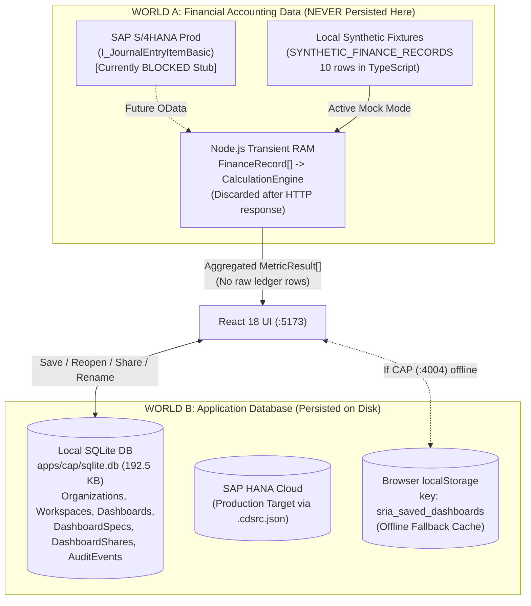
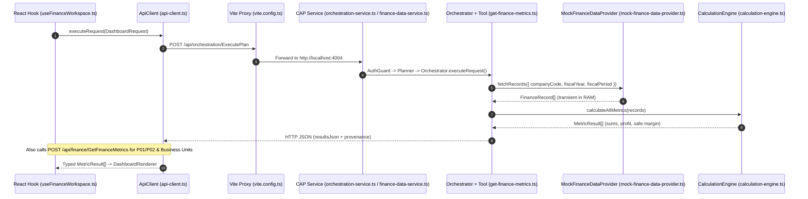
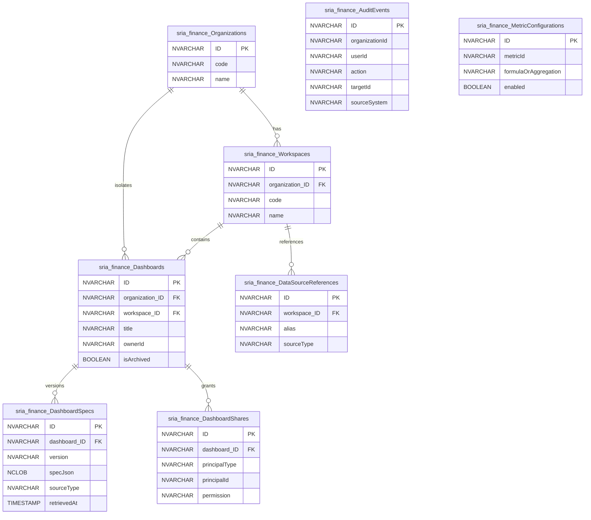

# Data Storage, Access & Database Architecture Guide

**Project:** Sria Info Tech AI Finance Dashboard Generator (`Sria Analytics`)  
**Focus:** Complete dynamics of where data lives, how it is accessed, what is stored locally on your device, and how databases work across SAP & Non-SAP layers.

---

## 1. The Golden Rule: Two Completely Separate Worlds of Data

To understand data in this system, separate it into two distinct categories:

1. **Financial Accounting Data (ERP / Ledger Data):**
   - Examples: Journal entries, GL accounts (`410000`, `510000`), revenue credits, expense debits, amounts, company codes (`1000`, `2000`).
   - **Stored in our app database?** **NO. NEVER.**
   - **Where it lives:** In **SAP S/4HANA** (`I_JournalEntryItemBasic`) in production, or in **in-code synthetic test fixtures** (`packages/contracts/src/fixtures/synthetic-fixtures.ts`) in local dev mode.
   - **Lifetime in our backend:** **Milliseconds (RAM only).** Fetched on demand → aggregated by `CalculationEngine` → discarded immediately.

2. **Application State & Configuration Data (Metadata):**
   - Examples: Saved dashboard titles, `DashboardSpec` JSON layouts, user sharing permissions, organization/workspace IDs, non-sensitive audit logs.
   - **Stored in our app database?** **YES.**
   - **Where it lives:** Locally in **SQLite** (`apps/cap/sqlite.db`), or in **SAP HANA Cloud** in production, with a browser **`localStorage`** fallback (`sria_saved_dashboards`) if the backend is offline.

---

## 2. Where Financial Data Lives & How Code Accesses It

### 2.1 Local Mode vs. Production Mode (`ProviderFactory`)
Controlled by the environment variable `FINANCE_DATA_PROVIDER` (defined in `.env`, templated in `.env.example`):

- **Default (`mock`):** `apps/cap/srv/lib/providers/provider-factory.ts` creates `MockFinanceDataProvider` (`mock-finance-data-provider.ts`).
  - It reads `SYNTHETIC_FINANCE_RECORDS` from `packages/contracts/src/fixtures/synthetic-fixtures.ts`.
  - There are **10 synthetic records** total:
    - **Company `1000`, FY `2026`, Period `01`:** Revenue `+$160,000` (`C`), Return `-$10,000` (`D`) → `$150,000`; Expenses `$60,000 + $30,000` → `$90,000`; Net Profit `$60,000`; Margin `40.00%`.
    - **Company `1000`, FY `2026`, Period `02`:** Revenue `$200,000`; Expenses `$80,000 + $60,000` → `$140,000`; Net Profit `$60,000`; Margin `30.00%`.
    - **Company `2000`, FY `2026`, Period `01`:** Revenue `$0`; Expenses `$25,000`; Net Profit `-$25,000`; Margin `0.00%` (zero-denominator protected).
    - **Company `2000`, FY `2026`, Period `02`:** Revenue `$50,000`; Expenses `$75,000`; Net Profit `-$25,000`; Margin `-50.00%`.
- **Production (`s4hana`):** `ProviderFactory` instantiates `S4HanaODataFinanceDataProvider` (`s4hana-odata-provider.ts`), which is currently an explicit **BLOCKED stub** throwing `S4HanaProviderBlockedError` until SAP BASIS configures a BTP Destination with OAuth2 credentials and Finance signs off on GL field mappings (`docs/domain/SAP-FIELD-MAPPING.md`).

### 2.2 Exact Data Access Chain (Code File by Code File)

**What happens if CAP (`localhost:4004`) is offline?**
`ApiClient` catches the network/timeout error and falls back seamlessly to `_localMockExecution()` / `_fetchFinanceSlice()` inside `apps/web/src/services/api-client.ts`, running the exact same deterministic math in the browser over `SYNTHETIC_FINANCE_RECORDS`.

---

## 3. Inside Your Local Database (`apps/cap/sqlite.db`)

Your local Windows device has a real SQLite database at:
- **`c:\Users\darla\OneDrive\Desktop\SAP,AI project\apps\cap\sqlite.db`** (192,512 bytes — active CAP database configured in `apps/cap/.cdsrc.json` and `.cdsrc.json`).
- *Note:* Root `sqlite.db` (4,096 bytes) is a minimal empty/stub file; CAP's `.cdsrc.json` routes database operations to `apps/cap/sqlite.db`.

### Entity-Relationship Diagram (Actual Tables on Disk)

### Actual Table Inventory in `apps/cap/sqlite.db` (Verified Directly)

| SQLite Table Name | CDS Source File | Current Rows | What It Stores |
|---|---|---|---|
| `sria_finance_Organizations` | `apps/cap/db/tenant.cds` | 50 | Tenant root boundaries (`ID`, `code`, `name`) |
| `sria_finance_Workspaces` | `apps/cap/db/tenant.cds` | 50 | Logical workspace containers under an Organization |
| `sria_finance_Dashboards` | `apps/cap/db/dashboard.cds` | 31 | Saved dashboard headers (`title`, `ownerId`, `isArchived`) |
| `sria_finance_DashboardSpecs` | `apps/cap/db/dashboard.cds` | 55 | Saved `DashboardSpec` JSON configurations (`specJson`, `version`) |
| `sria_finance_DashboardShares` | `apps/cap/db/dashboard.cds` | 7 | User/Role sharing grants (`READ` or `EDIT`) |
| `sria_finance_AuditEvents` | `apps/cap/db/metric-config.cds` | 87 | Metadata-only audit logs (`action`, `userId`, `sourceSystem`) |
| `sria_finance_MetricConfigurations` | `apps/cap/db/metric-config.cds` | 0 | DB table ready for dynamic metric governance (currently served via `BASELINE_METRIC_CATALOG`) |
| `sria_finance_DataSourceReferences` | `apps/cap/db/metric-config.cds` | 0 | Technical BTP destination aliases only (never passwords/tokens) |
| `cds_outbox_Messages` | `@sap/cds` internal | 0 | CAP framework outbox table |

---

## 4. All Storage Layers on Your Device (RAM vs Disk vs Browser)

1. **React Memory (RAM — Lost on Page Reload):**
   - `useFinanceWorkspace.ts` holds `currentSpec`, `periodSeries`, `buSlices`, `comparisonData`, and `recentDashboards`.
2. **Browser `localStorage` (Persists in Chrome/Edge):**
   - Key: `sria_saved_dashboards` (used by `ApiClient.saveDashboard`, `listDashboards`, `reopenDashboard`, `renameDashboard`, `deleteDashboard` **only** when the CAP backend at `:4004` fails/is unreachable).
3. **Node.js Backend RAM (Transient — Milliseconds):**
   - `FinanceRecord[]` returned by `MockFinanceDataProvider` or `S4HanaODataFinanceDataProvider` is summed in `CalculationEngine` and immediately released to garbage collection.
4. **Local Disk SQLite (`apps/cap/sqlite.db`):**
   - Persists dashboards, specs, shares, tenants, and audit logs across server restarts via `DashboardRepository` (`apps/cap/srv/lib/repositories/dashboard-repository.ts`).
5. **Environment Config (`.env` / `.cdsrc.json`):**
   - `.cdsrc.json` points CAP to SQLite locally and switches to `[production]` → `hana` + `xsuaa` when deployed via `mta.yaml`.

---

## 5. Data Lifecycle Dynamics: Save, Reopen (`isStale`), Refresh & Follow-ups

- **Save (`SaveDashboard`):** Persists the dashboard metadata + `specJson` into `Dashboards` and `DashboardSpecs` (version `1.0`), plus writes a `CREATE_DASHBOARD` row to `AuditEvents`.
- **Reopen (`ReopenDashboard`):** Loads the saved `specJson` from SQLite and **always returns `isStale: true`** (`apps/cap/srv/dashboard-lifecycle-service.ts`). Why? Because saved specs represent an older snapshot; the UI warns the user with an amber **"Stale Saved Snapshot"** badge until refreshed.
- **Refresh (`RefreshDashboard`):** Calls `FollowUpRouter.executeFollowUp('refresh', ...)` → re-runs `Orchestrator` + `CalculationEngine` against the active provider → saves a new spec version (`1.1`) → clears `isStale` to `false`.
- **Presentation Follow-ups vs. Data Follow-ups:**
  - *"Change chart to line"* / *"Rename"* → `PRESENTATION_ONLY` (updates UI/widgets using already-validated `results`; **zero** SAP/provider queries).
  - *"Switch to company 2000"* / *"Filter to period 02"* → `DATA_CHANGING` (triggers fresh authorized retrieval via CAP).

---

## 6. Security, Isolation & Secrets Rules

1. **Tenant Isolation (`DashboardRepository`):** Every query filters by `organization_ID = ctx.organizationId` resolved server-side from `AuthGuard` (`apps/cap/srv/lib/auth/auth-guard.ts`). A client cannot spoof another tenant's `dashboardId`.
2. **Ownership Checks:** Only the `ownerId` can update, rename, or archive (soft-delete `isArchived = 1`) a dashboard.
3. **Zero LLM Data Exposure:** `IntentService` (`apps/cap/srv/ai/intent-service.ts`) sends only the user's natural-language prompt to the LLM provider to extract `metricIds` and `filters`. Raw `FinanceRecord[]` and calculated numbers are never sent to or computed by an LLM.
4. **Zero Secrets in DB or Frontend:** Passwords, OAuth2 tokens, and API keys never enter SQLite (`DataSourceReferences` holds only alias names like `S4HANA_FINANCE_API`) or `apps/web`.

